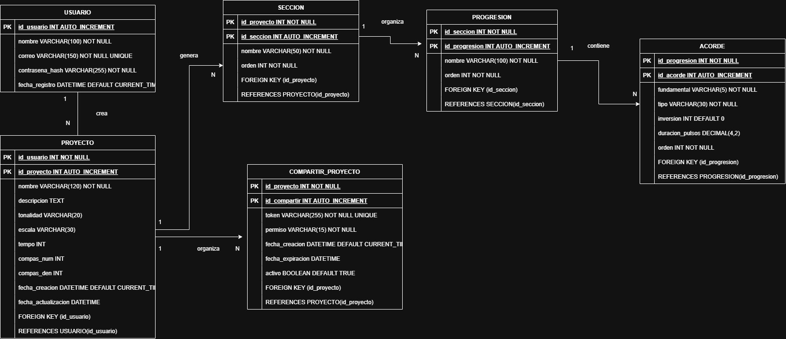

3. Modelo entidad-relación – ChordLab

1. Descripción general

El modelo entidad-relación de ChordLab representa la estructura de almacenamiento de información necesaria para administrar usuarios, proyectos musicales, secciones, progresiones armónicas, acordes y enlaces para compartir composiciones.

La base de datos estará implementada en MySQL y permitirá mantener organizada la información de cada usuario y sus composiciones, estableciendo relaciones entre los diferentes elementos que conforman un proyecto musical.

2. Entidades principales

El modelo estará compuesto por seis entidades:

2.1 USUARIO

Almacena la información de las personas registradas en la plataforma.

Atributo

Tipo de dato

Descripción

id_usuario (PK)

INT

Identificador único del usuario.

nombre

VARCHAR(100)

Nombre del usuario.

correo

VARCHAR(150)

Correo electrónico.

contrasena_hash

VARCHAR(255)

Contraseña almacenada mediante hash.

fecha_registro

DATETIME

Fecha de creación de la cuenta.

2.2 PROYECTO

Almacena los proyectos musicales creados por cada usuario.

Atributo

Tipo de dato

Descripción

id_proyecto (PK)

INT

Identificador único del proyecto.

id_usuario (FK)

INT

Usuario propietario del proyecto.

nombre

VARCHAR(120)

Nombre del proyecto musical.

descripcion

TEXT

Descripción del proyecto.

tonalidad

VARCHAR(20)

Tonalidad musical seleccionada.

escala

VARCHAR(30)

Escala musical utilizada.

tempo

INT

Velocidad musical expresada en BPM.

compas_num

INT

Numerador del compás.

compas_den

INT

Denominador del compás.

fecha_creacion

DATETIME

Fecha de creación del proyecto.

fecha_actualizacion

DATETIME

Última modificación del proyecto.

2.3 SECCION

Permite organizar las composiciones en diferentes partes de una canción, como introducción, verso, coro y puente.

Atributo

Tipo de dato

Descripción

id_seccion (PK)

INT

Identificador único de la sección.

id_proyecto (FK)

INT

Proyecto al que pertenece.

nombre

VARCHAR(50)

Nombre de la sección.

orden

INT

Posición de la sección dentro del proyecto.

2.4 PROGRESION

Almacena las secuencias armónicas que forman parte de cada sección musical.

Atributo

Tipo de dato

Descripción

id_progresion (PK)

INT

Identificador único de la progresión.

id_seccion (FK)

INT

Sección a la que pertenece.

nombre

VARCHAR(100)

Nombre de la progresión.

orden

INT

Posición de la progresión dentro de la sección.

2.5 ACORDE

Almacena las características de cada acorde que forma parte de una progresión armónica.

Atributo

Tipo de dato

Descripción

id_acorde (PK)

INT

Identificador único del acorde.

id_progresion (FK)

INT

Progresión a la que pertenece.

fundamental

VARCHAR(5)

Nota fundamental del acorde.

tipo

VARCHAR(30)

Tipo de acorde: mayor, menor, séptima, etc.

inversion

INT

Inversión del acorde.

duracion_pulsos

DECIMAL(4,2)

Duración del acorde expresada en pulsos.

orden

INT

Posición del acorde dentro de la progresión.

2.6 COMPARTIR_PROYECTO

Almacena los enlaces y permisos utilizados para compartir proyectos musicales con otras personas.

Atributo

Tipo de dato

Descripción

id_compartir (PK)

INT

Identificador del enlace compartido.

id_proyecto (FK)

INT

Proyecto que se comparte.

token

VARCHAR(255)

Código único del enlace de acceso.

permiso

VARCHAR(15)

Tipo de permiso: lectura o edición.

fecha_creacion

DATETIME

Fecha de generación del enlace.

fecha_expiracion

DATETIME

Fecha límite de acceso, si existe.

activo

BOOLEAN

Indica si el enlace continúa habilitado.

3. Relaciones entre las entidades

Las relaciones establecidas en el modelo son las siguientes:

USUARIO – PROYECTO (1): un usuario puede crear varios proyectos musicales, pero cada proyecto pertenece a un solo usuario.

PROYECTO – SECCION (1): un proyecto puede contener varias secciones, pero cada sección pertenece a un solo proyecto.

SECCION – PROGRESION (1): una sección puede contener varias progresiones armónicas, pero cada progresión pertenece a una sola sección.

PROGRESION – ACORDE (1): una progresión está formada por varios acordes, pero cada acorde pertenece a una sola progresión.

PROYECTO – COMPARTIR_PROYECTO (1): un proyecto puede tener varios enlaces para compartir, pero cada enlace corresponde a un solo proyecto.

