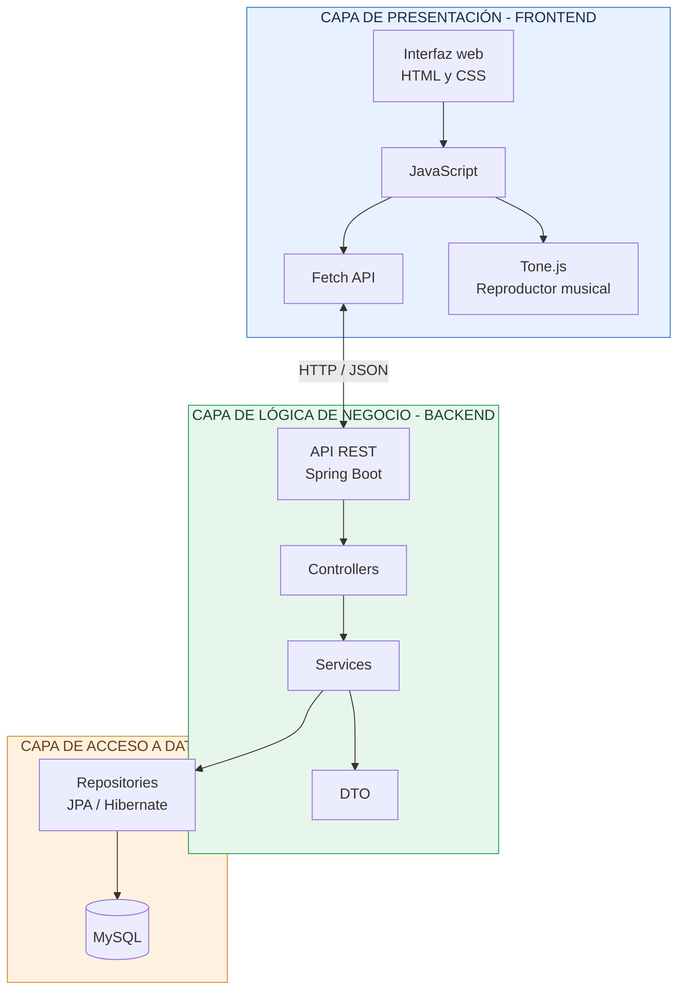

# 05. Arquitectura del sistema – ChordLab

## 1. Introducción

ChordLab utilizará una arquitectura de tres capas que permitirá organizar el funcionamiento de la plataforma y separar las responsabilidades de cada componente.

La aplicación estará dividida en una capa de presentación, una capa de lógica de negocio y una capa de acceso a datos. Estas capas trabajarán de manera conjunta para permitir que los usuarios creen proyectos musicales, generen acordes, construyan progresiones armónicas y almacenen sus composiciones.

La comunicación entre el frontend y el backend se realizará mediante una API REST, utilizando solicitudes HTTP e intercambio de información en formato JSON.

## 2. Arquitectura de tres capas

### 2.1 Capa de presentación (Frontend)

Es la parte de la aplicación con la que interactúa directamente el usuario. Se encargará de mostrar las interfaces y recibir las acciones realizadas dentro de la plataforma.

Se desarrollará utilizando:

- **HTML:** estructura de las páginas y componentes de la aplicación.
- **CSS:** diseño visual, distribución de elementos y adaptación a diferentes dispositivos.
- **JavaScript:** interacciones, validaciones y comunicación con el backend.
- **Fetch API:** envío y recepción de solicitudes HTTP hacia la API REST.
- **Tone.js:** generación y reproducción de sonidos mediante instrumentos virtuales.

Entre sus principales funciones se encuentran:

- Mostrar el formulario de registro e inicio de sesión.
- Presentar el panel de proyectos musicales.
- Permitir la creación y edición de composiciones.
- Mostrar los acordes y sus notas musicales.
- Visualizar acordes mediante representaciones de piano y guitarra.
- Permitir la reproducción de acordes y progresiones.
- Mostrar las diferentes secciones de una canción.
- Facilitar la consulta y edición de proyectos compartidos.

### 2.2 Capa de lógica de negocio (Backend)

Esta capa se encargará de procesar las solicitudes recibidas desde el frontend y ejecutar las operaciones necesarias para el funcionamiento del sistema.

Se desarrollará utilizando Java y Spring Boot.

Sus principales responsabilidades serán:

- Administrar el registro y autenticación de usuarios.
- Gestionar la creación, consulta, modificación y eliminación de proyectos.
- Procesar las operaciones relacionadas con las secciones musicales.
- Administrar las progresiones armónicas y sus acordes.
- Generar acordes a partir de notas fundamentales y tipos seleccionados.
- Construir progresiones de acuerdo con la tonalidad y escala musical.
- Validar la información recibida desde el frontend.
- Controlar los permisos de acceso a los proyectos.
- Procesar las solicitudes de la API REST y devolver respuestas JSON.

El backend estará organizado mediante diferentes componentes:

- **Controller:** recibe las solicitudes HTTP y devuelve las respuestas correspondientes.
- **Service:** contiene la lógica de negocio y los procesos musicales.
- **DTO:** define la estructura de los datos que se intercambian mediante la API.
- **Config:** contiene las configuraciones generales y de seguridad de la aplicación.

### 2.3 Capa de acceso a datos (Base de datos)

Esta capa se encargará de almacenar, consultar, actualizar y eliminar la información utilizada por ChordLab.

Se utilizará MySQL como sistema gestor de bases de datos y JPA con Hibernate para facilitar la comunicación entre Java y la base de datos.

Sus principales responsabilidades serán:

- Almacenar la información de los usuarios registrados.
- Guardar los proyectos musicales.
- Registrar las secciones de cada composición.
- Almacenar las progresiones armónicas.
- Guardar los acordes que forman cada progresión.
- Administrar los enlaces y permisos para compartir proyectos.
- Mantener las relaciones entre las diferentes entidades.

Para realizar las operaciones de persistencia se utilizarán los componentes Repository, que permitirán consultar y modificar los registros almacenados en MySQL.

## 3. Diagrama general de arquitectura

El siguiente diagrama representa la organización de las tres capas y la comunicación entre sus componentes.

## 4. Flujo de comunicación entre las capas

El funcionamiento general de ChordLab seguirá un proceso en el que cada capa realizará una tarea específica.

1. El usuario realiza una acción desde la interfaz web, como crear un proyecto o generar un acorde.
2. JavaScript identifica la acción y prepara la información necesaria.
3. Fetch API envía una solicitud HTTP al endpoint correspondiente de la API REST.
4. Spring Boot recibe la solicitud mediante un Controller.
5. El Service procesa la operación y ejecuta las validaciones necesarias.
6. Cuando se requiere consultar o almacenar información, el Service utiliza los Repository para comunicarse con MySQL mediante JPA e Hibernate.
7. El backend devuelve una respuesta en formato JSON.
8. El frontend recibe la respuesta y actualiza la información mostrada al usuario.

La reproducción de audio se realizará directamente en el navegador mediante Tone.js, utilizando los datos musicales obtenidos desde el backend.

## 5. Tecnologías utilizadas

Para el desarrollo de ChordLab se utilizarán las siguientes tecnologías:

### Frontend

- HTML5 para la estructura de la aplicación.
- CSS3 para el diseño y presentación de las interfaces.
- JavaScript para la programación de las interacciones.
- Fetch API para consumir los servicios de la API REST.
- Tone.js para la reproducción de acordes y progresiones musicales.

### Backend

- Java como lenguaje de programación.
- Spring Boot para el desarrollo del servidor y la API REST.
- Spring Data JPA para las operaciones de persistencia.
- Hibernate como herramienta de mapeo objeto-relacional.
- Spring Security para la protección de los servicios y la autenticación.

### Base de datos

- MySQL como sistema gestor de bases de datos.
- SQL para la definición y administración de la información.
- JPA y Hibernate para establecer la comunicación entre el backend y la base de datos.

### Herramientas de desarrollo

- Visual Studio Code como entorno de desarrollo.
- Git y GitHub para el control de versiones y almacenamiento del código.
- WSL con Ubuntu como entorno de ejecución y desarrollo.
- CURL para realizar pruebas de los servicios HTTP.

## 6. Organización general del proyecto

El repositorio de ChordLab estará organizado en tres módulos principales:

**Backend:** contendrá el código Java, los controladores, servicios, repositorios, entidades y configuraciones de Spring Boot.

**Frontend:** contendrá los archivos HTML, CSS, JavaScript y los recursos visuales utilizados por la interfaz.

**Database:** contendrá los scripts SQL necesarios para crear y administrar la estructura de la base de datos.

Además, se contará con una carpeta de documentación donde se registrarán los requerimientos, diagramas, diseño de la API, arquitectura y responsabilidades del equipo.

## 7. Seguridad y acceso a la información

La arquitectura contemplará mecanismos para proteger la información de los usuarios y sus proyectos.

Se utilizará autenticación mediante JWT para identificar a los usuarios y controlar el acceso a los servicios protegidos.

Las contraseñas se almacenarán mediante funciones seguras de hash y el backend verificará los permisos antes de permitir modificaciones o eliminaciones de proyectos.

Los proyectos compartidos contarán con enlaces y permisos de acceso que determinarán si una persona puede consultar o editar una composición.

## 8. Entorno de ejecución

El desarrollo y las pruebas de ChordLab se realizarán utilizando WSL con Ubuntu, Visual Studio Code y Git.

El backend se ejecutará mediante Spring Boot, utilizando el puerto 8080 durante el desarrollo. La base de datos MySQL estará configurada para recibir las conexiones del servidor.

El frontend realizará las solicitudes hacia la API REST mediante Fetch API. Durante la etapa de integración se configurará la comunicación entre ambos módulos y los permisos necesarios para las solicitudes entre diferentes orígenes, cuando corresponda.

## 9. Consideraciones de implementación

La arquitectura propuesta permitirá desarrollar cada módulo de manera organizada y facilitará la integración entre los integrantes del equipo.

La implementación se realizará de forma incremental. Primero se configurarán los componentes básicos del backend y la conexión con MySQL; posteriormente se desarrollarán los servicios de la API REST y las interfaces del frontend.

Finalmente, se integrarán las funcionalidades musicales, el reproductor de audio y las opciones para compartir composiciones.

## 10. Resultado esperado

Se espera contar con una aplicación web organizada en tres capas, en la que el frontend permita interactuar con las herramientas musicales, el backend procese las operaciones y MySQL almacene la información de los usuarios y sus composiciones.

La separación de responsabilidades permitirá mantener una estructura clara y facilitar las pruebas, modificaciones e integración de los diferentes módulos de ChordLab.