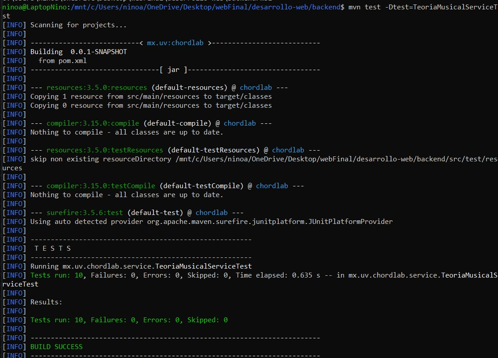
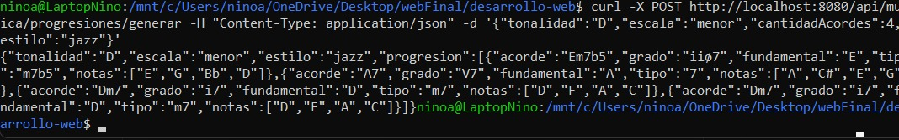

# Reporte de IA Desarrollo en el Proyecto

**Fecha:** 13/11/2026  
**Número de reporte:** 01  
**Integrante:** Nino Alessandro Navarro Lam  
**Entregable:** 2 – Backend básico (reporte de actividades R2)

---

# 1. Breve descripción de uso

Se utilizó Claude Code para generar el backend básico de ChordLab sobre el proyecto Spring Boot que César creó con Spring Initializr (commit `0cd0c55`). La intención fue cumplir los días 3, 4 y 5 del calendario del proyecto: una API REST con los métodos POST y GET de usuarios, proyectos, secciones, progresiones y acordes, conectada a MySQL y probada con CURL.

La herramienta generó las capas del backend: entidades JPA, repositorios, DTOs con validaciones, servicios, controladores, manejo de errores, CORS y cifrado de contraseñas con BCrypt. También generó la lógica musical (acordes, inversiones, escalas y progresiones), sus pruebas unitarias y un script de pruebas CURL. Además, revisó lo que el equipo ya había subido y detectó problemas en `esquema.sql`, en la versión de Java del `pom.xml` y en el README.

---

# 2. Evidencias de uso

| Evidencia | Formato |
|------------|------------------------|
| Herramienta | Claude Code (Anthropic), aplicación de escritorio |
| Modelo/temperatura | Claude Opus 5.5 (`claude-opus-5-5`) / no configurable en Claude Code |
| Prompt original | Junto con el prompt se adjuntaron el PDF de indicaciones del proyecto final y una exportación en texto del repositorio: *"Hola claude, necesito ayuda con mi proyecto de web. Te paso el repo de github y el pdf del profe para que sigamos las fechas y rprocesos de entrega tal cual esta ahi. Ya hicimos la primera entrega. Osea del dia 1 y 2, vamos con la teorica Entregable 1 diseño inicial dias 3,4 y 5. Backend Basico."*  Prompts de seguimiento, después de que el equipo subió el proyecto Spring Boot y el script de la base de datos: *"mis compañeros agregaron mas avance checalo y empezamos desde ahi"* *"osea en el archivo desarrollo-web, esta el pull y tus cambios con base a esos commits"* |
| Respuesta de IA | 1. **Lectura del calendario:** identificó que los días 3 a 5 corresponden al Entregable 2 (backend básico): API REST con POST y GET, conexión a MySQL, pruebas con CURL, reporte R2 en el día 5 y su release en GitHub. 2. **Revisión del repositorio:** encontró que en `esquema.sql` las líneas que empiezan con `----` o `---` sin espacio no son comentarios válidos en MySQL; que el usuario `chordlab` de MySQL no se crea en ningún script; que el `pom.xml` pedía Java 21 aunque en WSL solo está el JDK 17; que en el README `sudo mysql chordlab < database/esquema.sql` falla la primera vez porque la base no existe; y que `ChordlabApplicationTests` hace fallar `mvn test` si MySQL no está corriendo. 3. **Generación del backend** en `backend/src/main/java/mx/uv/chordlab/`: `config/` (CORS y BCrypt), `entity/` y `repository/` (las seis tablas del esquema con JPA y Spring Data), `dto/` (records con `@NotBlank`, `@Email`, `@Min`, `@Max`), `service/` y `controller/` (registro, login, perfil y POST/GET de proyectos, secciones, progresiones y acordes, con la cabecera temporal `X-Usuario-Id`) y `exception/` (`GlobalExceptionHandler` con respuestas 400, 401, 403, 404 y 409). 4. **Lógica musical** en `TeoriaMusicalService`: acordes mayores, menores, disminuidos, aumentados y de séptima, con inversiones y notas con octava para Tone.js; escalas mayores y menores; y progresiones pop, clásico, jazz, blues y aleatorio con semilla. Cada nota se guarda como letra más alteración para que la séptima de F sea Eb y no D#. 5. **Pruebas:** `TeoriaMusicalServiceTest` (10 pruebas unitarias) y `pruebas/curl-entregable2.sh` (24 casos que comparan el código HTTP esperado con el obtenido). 6. **Configuración e instrucciones:** `java.version` 17, dependencia `spring-security-crypto`, ruta base `/api`, corrección de comentarios de `esquema.sql` y pasos para probar en WSL (instalar MySQL, crear el usuario `chordlab`, exportar `DB_PASSWORD`, arrancar con `./mvnw spring-boot:run` y correr el script CURL). |
| Código anterior | Commit `0cd0c55` (proyecto Spring Boot y conexión a MySQL, de César) |
| Código posterior | Commit `a8325c5` (backend básico) |
| Diferencias entre versiones | `git diff --numstat 0cd0c55 a8325c5` <pre>7	1	backend/pom.xml 21	0	backend/src/main/java/mx/uv/chordlab/config/CorsConfig.java 16	0	backend/src/main/java/mx/uv/chordlab/config/PasswordConfig.java 31	0	backend/src/main/java/mx/uv/chordlab/controller/AcordeController.java 11	0	backend/src/main/java/mx/uv/chordlab/controller/Cabeceras.java 54	0	backend/src/main/java/mx/uv/chordlab/controller/MusicaController.java 36	0	backend/src/main/java/mx/uv/chordlab/controller/ProgresionController.java 39	0	backend/src/main/java/mx/uv/chordlab/controller/ProyectoController.java 31	0	backend/src/main/java/mx/uv/chordlab/controller/SeccionController.java 34	0	backend/src/main/java/mx/uv/chordlab/controller/UsuarioController.java 18	0	backend/src/main/java/mx/uv/chordlab/dto/AcordeGenerado.java 6	0	backend/src/main/java/mx/uv/chordlab/dto/AcordeProgresion.java 26	0	backend/src/main/java/mx/uv/chordlab/dto/AcordeRequest.java 19	0	backend/src/main/java/mx/uv/chordlab/dto/AcordeResponse.java 14	0	backend/src/main/java/mx/uv/chordlab/dto/ErrorResponse.java 16	0	backend/src/main/java/mx/uv/chordlab/dto/GenerarAcordeRequest.java 25	0	backend/src/main/java/mx/uv/chordlab/dto/GenerarProgresionRequest.java 13	0	backend/src/main/java/mx/uv/chordlab/dto/LoginRequest.java 7	0	backend/src/main/java/mx/uv/chordlab/dto/LoginResponse.java 5	0	backend/src/main/java/mx/uv/chordlab/dto/PerfilResponse.java 5	0	backend/src/main/java/mx/uv/chordlab/dto/ProgresionGenerada.java 16	0	backend/src/main/java/mx/uv/chordlab/dto/ProgresionRequest.java 20	0	backend/src/main/java/mx/uv/chordlab/dto/ProgresionResponse.java 31	0	backend/src/main/java/mx/uv/chordlab/dto/ProyectoRequest.java 26	0	backend/src/main/java/mx/uv/chordlab/dto/ProyectoResponse.java 20	0	backend/src/main/java/mx/uv/chordlab/dto/RegistroRequest.java 3	0	backend/src/main/java/mx/uv/chordlab/dto/RegistroResponse.java 16	0	backend/src/main/java/mx/uv/chordlab/dto/SeccionRequest.java 12	0	backend/src/main/java/mx/uv/chordlab/dto/SeccionResponse.java 50	0	backend/src/main/java/mx/uv/chordlab/entity/Acorde.java 56	0	backend/src/main/java/mx/uv/chordlab/entity/CompartirProyecto.java 34	0	backend/src/main/java/mx/uv/chordlab/entity/Progresion.java 79	0	backend/src/main/java/mx/uv/chordlab/entity/Proyecto.java 34	0	backend/src/main/java/mx/uv/chordlab/entity/Seccion.java 40	0	backend/src/main/java/mx/uv/chordlab/entity/Usuario.java 8	0	backend/src/main/java/mx/uv/chordlab/exception/ConflictoException.java 71	0	backend/src/main/java/mx/uv/chordlab/exception/GlobalExceptionHandler.java 8	0	backend/src/main/java/mx/uv/chordlab/exception/NoAutorizadoException.java 8	0	backend/src/main/java/mx/uv/chordlab/exception/ProhibidoException.java 8	0	backend/src/main/java/mx/uv/chordlab/exception/RecursoNoEncontradoException.java 9	0	backend/src/main/java/mx/uv/chordlab/repository/AcordeRepository.java 9	0	backend/src/main/java/mx/uv/chordlab/repository/CompartirProyectoRepository.java 9	0	backend/src/main/java/mx/uv/chordlab/repository/ProgresionRepository.java 9	0	backend/src/main/java/mx/uv/chordlab/repository/ProyectoRepository.java 9	0	backend/src/main/java/mx/uv/chordlab/repository/SeccionRepository.java 10	0	backend/src/main/java/mx/uv/chordlab/repository/UsuarioRepository.java 65	0	backend/src/main/java/mx/uv/chordlab/service/AcordeService.java 56	0	backend/src/main/java/mx/uv/chordlab/service/ProgresionService.java 77	0	backend/src/main/java/mx/uv/chordlab/service/ProyectoService.java 48	0	backend/src/main/java/mx/uv/chordlab/service/SeccionService.java 333	0	backend/src/main/java/mx/uv/chordlab/service/TeoriaMusicalService.java 65	0	backend/src/main/java/mx/uv/chordlab/service/UsuarioService.java 4	1	backend/src/main/resources/application.properties 98	0	backend/src/test/java/mx/uv/chordlab/service/TeoriaMusicalServiceTest.java 6	6	database/esquema.sql 242	0	docs/IAG/Integrante2-Nino/r-ia-doc.md -	-	docs/evidencias/Entregable2/CURL_POST_GET.jpeg -	-	docs/evidencias/Entregable2/Mvn-Test.jpeg -	-	docs/evidencias/Entregable2/servidor.jpeg -	-	docs/evidencias/Entregable2/tablas.jpeg 153	105	docs/reportes/r-act-02.md 128	0	pruebas/curl-entregable2.sh</pre>Solo en `backend/`: 54 archivos, 1775 líneas agregadas y 2 eliminadas. |
| Prueba de funcionamiento | Pruebas unitarias: `./mvnw test -Dtest=TeoriaMusicalServiceTest` → 10 pruebas, 0 fallos.  CURL: `curl -i -X POST http://localhost:8090/api/musica/progresiones/generar -H "Content-Type: application/json" -d '{"tonalidad":"C","escala":"mayor","cantidadAcordes":4,"estilo":"pop"}'` → `200 OK` con la progresión `C (I) – G (V) – Am (vi) – F (IV)`. Script completo: `API=http://localhost:8090/api bash pruebas/curl-entregable2.sh` → 24 casos con el código HTTP esperado.  |
| Código de uso | Generación / Revisión / Pruebas |
| Reflexión del estudiante | La IA generó en una sola sesión la estructura completa del backend, pero no lo hizo sin contexto: primero revisó el proyecto que ya habíamos subido y el script de la base de datos, y encontró errores que no habíamos visto, como los comentarios de `esquema.sql` que MySQL no acepta y la versión de Java que no coincidía con la instalada en WSL. Tuvimos que adaptar el código al proyecto de César, ajustar la versión de Java y crear el usuario de MySQL a mano para que todo arrancara.  Lo más útil fue entender cómo se separan las capas: el controlador recibe la petición, el DTO valida los datos con `@Valid`, el servicio aplica las reglas y el repositorio guarda en MySQL. En la parte musical aprendí por qué cada nota se guarda como letra y alteración: si solo se contaran semitonos, la séptima de F saldría como D# en lugar de Eb. Verifiqué el resultado con las pruebas unitarias y con el script CURL contra MySQL en WSL.  Lo que haría distinto es subir el backend en varios commits pequeños (configuración, entidades, endpoints y lógica musical) en lugar de uno solo, para que el historial muestre mejor cómo se construyó y qué hizo cada integrante. |

---

## Observaciones adicionales

- La sesión fue interactiva: además del código, la herramienta explicó el funcionamiento de cada capa y de la lógica musical. Esas explicaciones se registran como consultas en `r-ia-doc-01.md`.
- Cuando se tomaron las capturas el backend corría en el puerto 8080. Después el equipo lo dejó en 8090, como indica `docs/04-api.md`, por eso los comandos de este reporte usan 8090.
- La cabecera `X-Usuario-Id` es temporal. Se reemplazará por autenticación con JWT en el Entregable 3.
