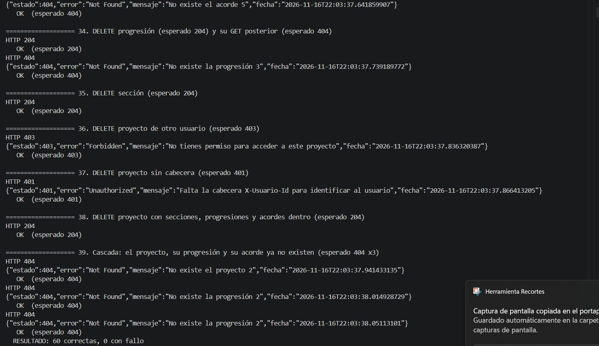

# Reporte de IA Desarrollo en el Proyecto

**Fecha:** 16/11/2026  
**Número de reporte:** 02  
**Integrante:** Nino Alessandro Navarro Lam  
**Entregable:** 3 – API REST completa (reporte de actividades R3)

---

# 1. Breve descripción de uso

Se utilizó Claude Code para revisar los commits del Entregable 3 contra el calendario del proyecto y para corregir un problema de seguridad del backend. Los PUT y DELETE ya verificaban que el proyecto perteneciera al usuario, pero los GET y POST anidados de secciones, progresiones y acordes no lo hacían: ni siquiera pedían la cabecera `X-Usuario-Id`, así que cualquier persona podía consultar o agregar datos en el proyecto de otro usuario. Esto incumplía el requisito RNF05 y la regla 1 de `docs/04-api.md`.

La herramienta agregó la verificación de propietario en esos 7 endpoints, actualizó los scripts de pruebas CURL para que envíen la cabecera y agregó pruebas nuevas que comprueban los casos de acceso no permitido (403) y sin cabecera (401).

---

# 2. Evidencias de uso

| Evidencia | Formato |
|------------|------------------------|
| Herramienta | Claude Code (Anthropic), aplicación de escritorio |
| Modelo/temperatura | Claude Opus 5.5 (`claude-opus-5-5`) / no configurable en Claude Code |
| Prompt original | [Ver prompt](#prompt-original) |
| Respuesta de IA | [Ver respuesta](#respuesta-de-ia) |
| Código anterior | Commit [`e475549`](https://github.com/CarlosLR19/desarrollo-web/commit/e475549) |
| Código posterior | Commit [`c0eb130`](https://github.com/CarlosLR19/desarrollo-web/commit/c0eb130) |
| Diferencias entre versiones | [Ver salida de `git diff --numstat`](#diferencias-entre-versiones) |
| Prueba de funcionamiento | [Ver pruebas](#prueba-de-funcionamiento) |
| Código de uso | Revisión / Depuración / Modificación / Pruebas |
| Reflexión del estudiante | [Ver reflexión](#reflexión-del-estudiante) |

> El prompt y la respuesta se copian como subsecciones y se enlazan desde la tabla.

## Prompt original

> resumeme lo que hicieron mis companeros en este entregable 3

Prompts de seguimiento de la misma sesión:

> dime como arreglar la verificacion de propietario para que verifique el usuario y asegure que es de el.


## Respuesta de IA

1. **Revisión del Entregable 3.** Comparó los commits de César (`9601f3e`) y Carlos (`601d383`) con el diagrama de Gantt del proyecto: PUT y DELETE, filtros, observaciones, validación de respuestas HTTP y persistencia. Ejecutó las pruebas en WSL; el script del Entregable 3 daba 52 verificaciones correctas, pero detectó que estos endpoints no verificaban al propietario del proyecto:
   - `GET` y `POST /proyectos/{id}/secciones`
   - `GET` y `POST /secciones/{id}/progresiones`
   - `GET /progresiones/{id}`
   - `GET` y `POST /progresiones/{id}/acordes`
2. **Explicación de la solución.** Reutilizar los métodos `buscarDelUsuario(...)` que ya usan los PUT y DELETE (404 si el recurso no existe, 403 si no es del usuario) y recibir el usuario con `@RequestHeader(Cabeceras.USUARIO)` (401 si falta la cabecera).


## Diferencias entre versiones

```
$ git diff --numstat e475549 c0eb130
2	0	.gitattributes
7	4	backend/src/main/java/mx/uv/chordlab/controller/AcordeController.java
10	6	backend/src/main/java/mx/uv/chordlab/controller/ProgresionController.java
7	4	backend/src/main/java/mx/uv/chordlab/controller/SeccionController.java
13	6	backend/src/main/java/mx/uv/chordlab/service/AcordeService.java
7	7	backend/src/main/java/mx/uv/chordlab/service/ProgresionService.java
4	4	backend/src/main/java/mx/uv/chordlab/service/SeccionService.java
7	7	pruebas/curl-entregable2.sh
35	11	pruebas/curl-entregable3.sh
```

## Prueba de funcionamiento

```bash
API=http://localhost:8090/api bash pruebas/curl-entregable3.sh
```

Resultado: **60 correctas, 0 con fallo**. Antes eran 52; las 8 nuevas corresponden a los pasos 12a a 12g:

| Paso | Prueba | Esperado |
|---|---|---|
| 12a | Usuario B lista las secciones del proyecto de A | 403 |
| 12b | Listar secciones sin cabecera | 401 |
| 12c | Usuario B agrega una sección al proyecto de A | 403 |
| 12d | Usuario B lista las progresiones de una sección de A | 403 |
| 12e | Usuario B consulta una progresión de A | 403 |
| 12f | Usuario B agrega un acorde a la progresión de A | 403 |
| 12g | Usuario A sigue viendo sus 2 secciones | 200 |

Además, `./mvnw test -Dtest=TeoriaMusicalServiceTest` da 10 pruebas sin fallos, y `curl-entregable2.sh` solo devuelve error en los casos que esperan error.



## Reflexión del estudiante

`<En esta entrega la IA fue de gran ayua para saber como implementar la verificacion del propietario para GET y POST reutilizando los de PUT y DELETE.>`

---

## Observaciones adicionales

- La cabecera `X-Usuario-Id` sigue siendo temporal: identifica al usuario, pero no lo autentica. Con la verificación de propietario ya en todos los endpoints, al integrar JWT bastará con obtener el `idUsuario` del token en lugar de la cabecera.
