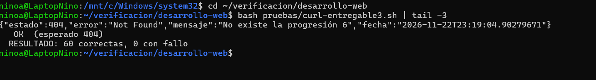

# Reporte de IA Desarrollo en el Proyecto

**Fecha:** 22/11/2026  
**Número de reporte:** 04  
**Integrante:** Nino Alessandro Navarro Lam  
**Entregable:** 5 – Pruebas y documentación (reporte de actividades R5)

---

# 1. Breve descripción de uso

Se utilizó Claude Code para documentar la verificación de la ejecución del proyecto en WSL y para integrar el reporte R5.

El estudiante clonó el repositorio en una carpeta nueva de WSL y lo ejecutó siguiendo solo el README. Después, la herramienta:

- guardó las 10 capturas de esa verificación en el repositorio;
- las registró como evidencia en el reporte R5.

Cuando César subió su propia versión de `r-act-05.md`, la herramienta:

- combinó las dos versiones en un solo reporte con el formato del profesor;
- volvió a enlazar las capturas de MySQL en el plan de pruebas;
- corrigió el `r-act-04`, que anunciaba capturas que nunca se tomaron.

---

# 2. Evidencias de uso

| Evidencia | Formato |
|------------|------------------------|
| Herramienta | Claude Code (Anthropic), aplicación de escritorio |
| Modelo/temperatura | Claude Opus 5.5 (`claude-opus-5-5`) / no configurable en Claude Code |
| Prompt original | [Ver prompt](#prompt-original) |
| Respuesta de IA | [Ver respuesta](#respuesta-de-ia) |
| Código anterior | Commit [`0ef2139`](https://github.com/CarlosLR19/desarrollo-web/commit/0ef2139) |
| Código posterior | Commit [`a8ab750`](https://github.com/CarlosLR19/desarrollo-web/commit/a8ab750) |
| Diferencias entre versiones | [Ver salida de `git diff --numstat`](#diferencias-entre-versiones) |
| Prueba de funcionamiento | [Ver pruebas](#prueba-de-funcionamiento) |
| Código de uso | Documentación / Revisión / Modificación |
| Reflexión del estudiante | [Ver reflexión](#reflexión-del-estudiante) |

> El prompt y la respuesta se copian como subsecciones y se enlazan desde la tabla.

## Prompt original

Se compartió la captura del paso 8 de la verificación en WSL (persistencia): el proyecto seguía en la lista después de reiniciar el backend.

Prompt de seguimiento de la misma sesión:

> ya hice pull, juntalas jeje y checa q nada falte y este todo bien

## Respuesta de IA

1. **Capturas de la verificación.** Copió las 10 capturas a `docs/evidencias/entregable5/`, con nombres ordenados del `E5_WSL_01_clon.png` al `E5_WSL_10_persistencia.png`.
2. **Registro en el R5.** Actualizó `r-act-05.md`:
   - en la sección 1 agregó los 8 pasos de la verificación y sus resultados reales (versiones, puerto 8090, 60/60 en CURL y persistencia);
   - en la sección 2.2 agregó la tabla de las 10 capturas;
   - quitó la verificación de las actividades pendientes.
3. **Combinación de las dos versiones del R5.** César subió en `0ef2139` otra versión de `r-act-05.md`. La herramienta tomó como base la versión con el formato del profesor (secciones 1 a 7, tabla de commits y campos de IA) y le incorporó lo que aportaba la de César:
   - la tabla de resultados de las pruebas;
   - el comportamiento comprobado en las pruebas de error;
   - la tabla de módulos verificados;
   - su commit en la tabla de commits;
   - la conclusión, en "Observaciones adicionales".
4. **Plan de pruebas.** Al reorganizar las tablas de `pruebas.md`, se habían quitado los enlaces a las 7 capturas de MySQL. Se agregó la sección "5. Persistencia en MySQL", que relaciona cada captura con su prueba, sin modificar las tablas de César.
5. **Corrección del R4.** La sección 2.2 de `r-act-04.md` anunciaba 6 capturas `E4_*.png` que no existían. Se reemplazaron por 7 capturas existentes que muestran esas pantallas.
## Diferencias entre versiones

```
$ git diff --numstat 0ef2139 a8ab750
-	-	docs/evidencias/entregable5/E5_WSL_01_clon.png
-	-	docs/evidencias/entregable5/E5_WSL_02_requisitos.png
-	-	docs/evidencias/entregable5/E5_WSL_03_tablas_mysql.png
-	-	docs/evidencias/entregable5/E5_WSL_04_backend.png
-	-	docs/evidencias/entregable5/E5_WSL_05_catalogo_api.png
-	-	docs/evidencias/entregable5/E5_WSL_06_pagina_thymeleaf.png
-	-	docs/evidencias/entregable5/E5_WSL_07_frontend_proyectos.png
-	-	docs/evidencias/entregable5/E5_WSL_08_reproductor_piano_guitarra.png
-	-	docs/evidencias/entregable5/E5_WSL_09_pruebas_curl.png
-	-	docs/evidencias/entregable5/E5_WSL_10_persistencia.png
15	1	docs/evidencias/pruebas/pruebas.md
8	7	docs/reportes/r-act-04.md
181	92	docs/reportes/r-act-05.md
```

Los guiones (`-`) indican archivos binarios: las capturas.

## Prueba de funcionamiento

**Verificación en WSL hecha por el estudiante**, desde un clon limpio y siguiendo solo el README:

| Paso | Resultado |
|---|---|
| 1. Clonación | `git clone` sin credenciales; último commit `40332c5` |
| 2. Requisitos | OpenJDK 21.0.13, Maven 3.9.12 y MySQL 8.4.13 |
| 3. Base de datos | Las 6 tablas de `chordlab` |
| 4. Backend | `Started ChordlabApplication` en el puerto 8090, conectado a MySQL |
| 5. API y Thymeleaf | JSON de `/api/musica/catalogo` y tabla de `/api/pagina` |
| 6. Frontend | Registro, proyecto nuevo y progresión con piano y guitarra |
| 7. Pruebas CURL | `RESULTADO: 60 correctas, 0 con fallo` |
| 8. Persistencia | El proyecto sigue después de reiniciar el backend |

Las capturas de cada paso están en `docs/evidencias/entregable5/`.

**Revisión de la documentación** que hizo la herramienta:
- Comprobó que cada captura copiada correspondiera a su nombre (por ejemplo, `E5_WSL_09` muestra el resultado 60/60).
- Revisó que las capturas de MySQL enlazadas en `pruebas.md` mostraran lo que indica la tabla: la sección "Verso", la progresión "C mayor · clasico", el enlace con 7 días de expiración y el proyecto PRUEBA4-CAMBIOS.
- Verificó los enlaces de los documentos que cambiaron: 7 en `r-act-04.md`, 20 en `r-act-05.md` y 29 en `pruebas.md`. Todos llevan a archivos existentes.
- Revisó los enlaces del README, los reportes, los registros de IA y `docs/`, sin encontrar ninguno roto.



## Reflexión del estudiante

`<Escribe aquí tu reflexión sobre lo que aprendiste al verificar el proyecto desde un clon limpio y al combinar el trabajo del equipo.>`

---

## Observaciones adicionales

- La verificación en WSL la ejecutó el estudiante en su propio equipo. La herramienta solo dio la guía y revisó las capturas.
- Las consultas de esta sesión se registran en [r-ia-doc-04.md](r-ia-doc-04.md): la guía de verificación, la tilde en la terminal, el usuario que pedía GitHub, la contraseña de MySQL y cómo hacer `git pull` sin perder cambios.
